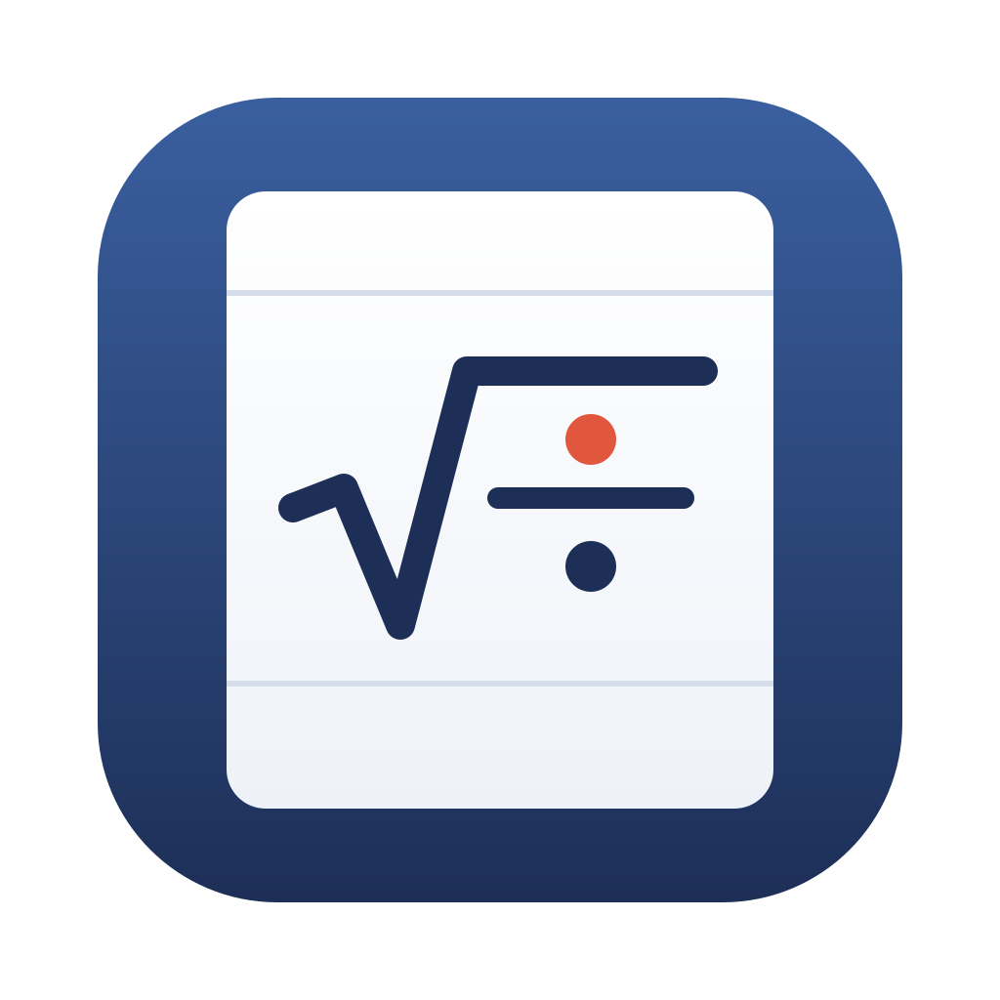
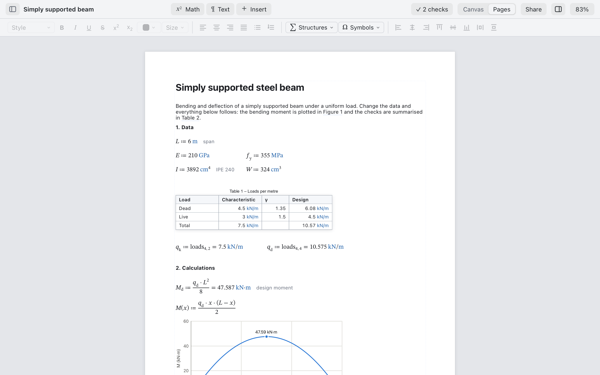
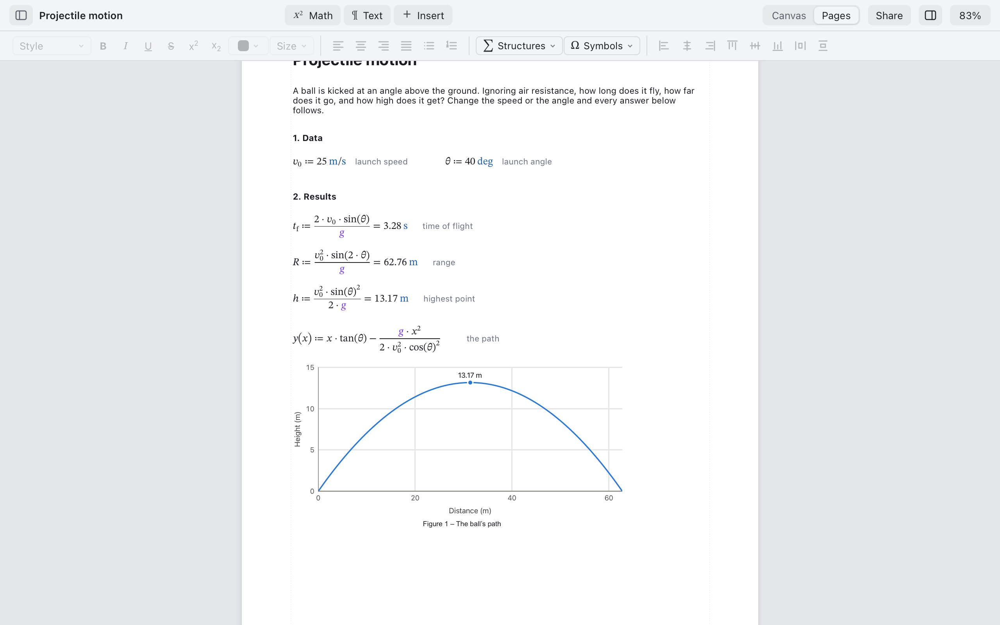
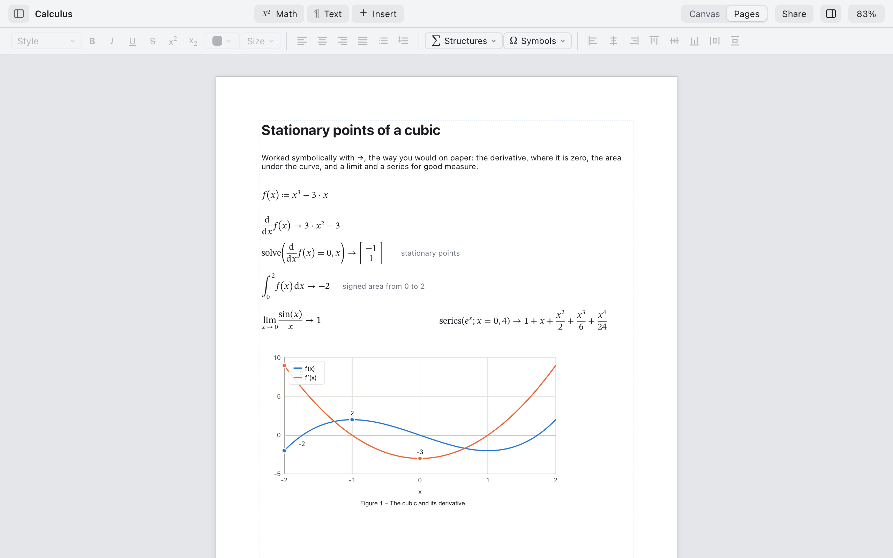
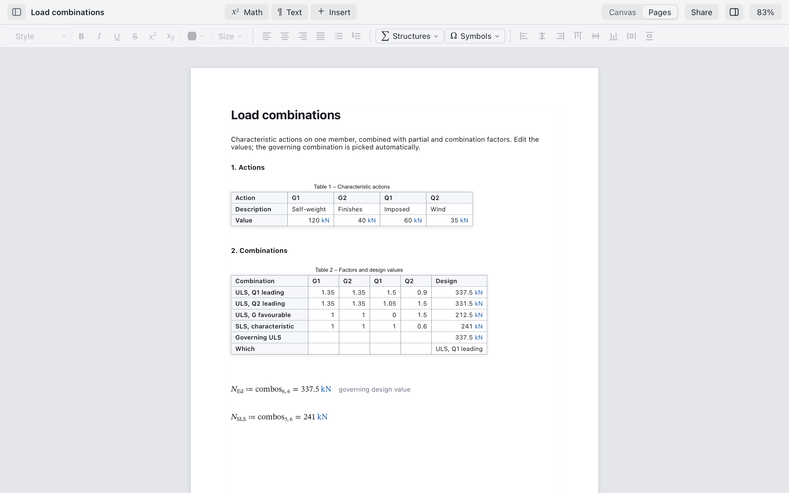
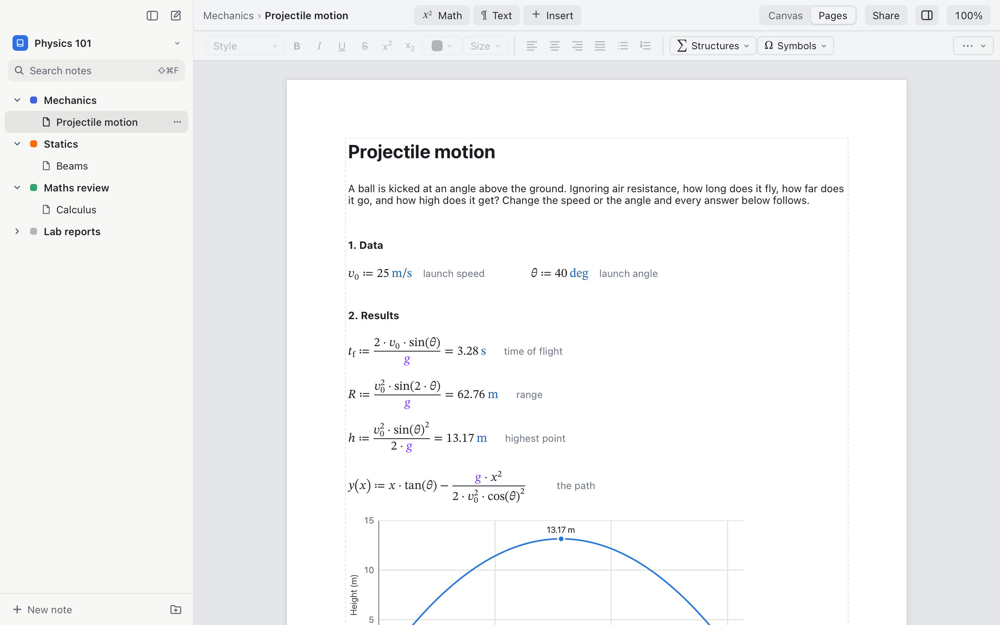

<p align="center">
  
</p>

<h1 align="center">Quire</h1>

<p align="center">
  <b>Calculations you can read: live maths with units, on paper you can print.</b>
</p>

<p align="center">
  Write maths the way you would on paper, and Quire works out every result as you type, units
  included. For engineers writing calculation reports, and for students and teachers keeping
  course notes. It opens SMath Studio worksheets, runs on macOS, Windows and Linux, and in the browser.
</p>

<p align="center">
  <a href="https://github.com/guidofraga/quire/actions/workflows/ci.yml"></a>
  <a href="https://github.com/guidofraga/quire/releases/latest"></a>
  <a href="#license"></a>
  
  
</p>

<p align="center">
  <a href="https://guidofraga.github.io/quire/"></a>
</p>

<p align="center">
  <a href="#a-tour">A tour</a> ·
  <a href="#why-quire">Why Quire</a> ·
  <a href="#what-it-does">What it does</a> ·
  <a href="#download">Download</a> ·
  <a href="#build-from-source">Build from source</a> ·
  <a href="#contributing">Contributing</a> ·
  <a href="#license">License</a>
</p>

<br>

<p align="center">
  <picture>
    <source media="(prefers-color-scheme: dark)" srcset="docs/images/hero-dark.png">
    
  </picture>
  <br><sub><b>Simply supported beam</b>, one of Quire's templates. <a href="https://guidofraga.github.io/quire/?open=https://raw.githubusercontent.com/guidofraga/quire/main/crates/quire-service/templates/beam.json">Open it in your browser</a> and change the span.</sub>
</p>

## A tour

Every picture is a real document, photographed by the app's own test setup (`npm --prefix app run screenshots`). The links open the same document in your browser, ready to edit.

<table>
<tr>
<td width="50%" valign="top"><p align="center"><sub><b>Units everywhere.</b> Results come out in the units you work in, and adding a length to a force is an error that says so. <a href="https://guidofraga.github.io/quire/?open=https://raw.githubusercontent.com/guidofraga/quire/main/docs/examples/projectile.quire/document.json">Open it</a></sub></p></td>
<td width="50%" valign="top"><p align="center"><sub><b>Symbolic maths.</b> Derivatives, integrals, equations, limits and series with →, written as on paper. <a href="https://guidofraga.github.io/quire/?open=https://raw.githubusercontent.com/guidofraga/quire/main/docs/examples/calculus.quire/document.json">Open it</a></sub></p></td>
</tr>
<tr>
<td width="50%" valign="top"><p align="center"><sub><b>Spreadsheet tables.</b> Cells hold values with units and formulas like <code>=SUM(B2:B4)</code>, and the maths reads them back. <a href="https://guidofraga.github.io/quire/?open=https://raw.githubusercontent.com/guidofraga/quire/main/crates/quire-service/templates/combinations.json">Open it</a></sub></p></td>
<td width="50%" valign="top"><p align="center"><sub><b>Notebooks.</b> A course's notes in sections that save themselves, as in OneNote or Obsidian. A notebook is just a folder. (Desktop app)</sub></p></td>
</tr>
</table>

## Why Quire

- **Units everywhere.** Type `12 kN/m` and `6 m`, and the moment comes out in kN·m. A wrong unit is an error, not a wrong answer.
- **Results you can trust.** Every change re-evaluates the whole document in well under a millisecond, and the test suite checks real reports against results worked out independently.
- **It reads like paper.** Fractions, roots and matrices are typeset as you type, next to text, tables and plots, on pages that print and export to PDF with bookmarks and links.
- **Your files.** Documents are readable JSON that diffs well in Git; a notebook is an ordinary folder. Nothing is locked in, and every document opens in later versions.
- **Opens SMath Studio worksheets.** `.sm` files open as Quire documents and compute the same results.
- **Share a link.** **Share** puts a whole document in a link that opens, live and editable, in anyone's browser. Nothing is uploaded: the document travels inside the link.
- **Free and open.** The engine is MIT or Apache-2.0, the app GPL-3.0.

## What it does

| Area | Highlights |
|---|---|
| **Maths** | Units without markers, functions, matrices, `sum`, `int`, `diff`, `solve` (roots, systems), ODEs (`rkfixed`), fitting and statistics, built-in constants, errors that say what is wrong |
| **Symbolic** | `→` for derivatives, integrals (substitution, by parts, partial fractions), `solve` up to degree four, limits, series, `factor`, `expand`, `simplify` |
| **Documents** | Rich text with live maths in sentences, spreadsheet tables, 2D plots, images, numbered headings and captions, cross-references, contents lists, summary of checks |
| **Pages** | A free canvas or A4/Letter pages with headers and footers, PDF export with bookmarks and links, templates |
| **Notes** | Notebooks of sections and notes, search across notes, autosave (desktop app) |
| **Sharing** | The web version, documents in links, copy and paste to Word and Google Docs as equations, LaTeX, CSV |
| **Accessibility** | The whole app works from the keyboard and with VoiceOver; maths is read as words |

Every feature in detail: [docs/features.md](docs/features.md).

## Download

Installers for Windows (`.msi`, `.exe`), macOS (`.dmg`, Apple silicon and Intel) and Linux (`.AppImage`, `.deb`, `.rpm`) are on the [latest release](https://github.com/guidofraga/quire/releases/latest). Quire then updates itself in one click (with the `.deb` or `.rpm`, through your package manager).

The installers aren't code-signed yet, so the first launch shows a warning:

- **macOS:** open Quire once and dismiss the message, then choose **System Settings ▸ Privacy & Security ▸ Open Anyway** and confirm.
- **Windows:** in the SmartScreen dialog, choose **More info ▸ Run anyway**.
- **Linux:** make the AppImage executable first (`chmod +x Quire_*.AppImage`), or install the `.deb` or `.rpm`.

Or skip the download: [Quire runs in your browser](https://guidofraga.github.io/quire/).

## Build from source

You need Rust (`rustup` installs it) and Node 22; [CONTRIBUTING.md](CONTRIBUTING.md) has the details.

```bash
npm --prefix app ci
```

```bash
npm --prefix app run tauri dev
```

The engine also works on the command line:

```bash
cargo run -q -p quire-cli -- calc "2 m + 30 cm" --in mm
```

`quire eval <doc>` prints a document's calculations, `quire check <doc>` compares them with known results, and `quire import file.sm out.quire` converts an SMath worksheet.

| Crate | What it does |
|---|---|
| [quire-ast](crates/quire-ast) | Linear maths syntax: lexer, parser, canonical printer |
| [quire-units](crates/quire-units) | Dimensions and the unit table |
| [quire-eval](crates/quire-eval) | The engine: evaluation, worksheets, spreadsheet tables, plots, symbolic maths |
| [quire-doc](crates/quire-doc) | Loading `.quire` and `.quirez` documents |
| [quire-smath](crates/quire-smath) | Importing SMath Studio worksheets |
| [quire-service](crates/quire-service) | What the app asks the engine for; templates; notebooks |
| [quire-web](crates/quire-web) | The engine as WebAssembly, for the web version |
| [quire-cli](crates/quire-cli) | The `quire` command, and `quire serve` for UI work in a browser |

How it all fits together: [docs/03-code-map.md](docs/03-code-map.md).

## Contributing

Contributions are welcome. [CONTRIBUTING.md](CONTRIBUTING.md) covers setup, the checks to run and how pull requests work, and [docs/](docs/README.md) has the architecture, file format, guidelines, testing and releasing.

## License

- The engine crates, the file-format spec and the schema: **MIT OR Apache-2.0** ([LICENSE-MIT](LICENSE-MIT), [LICENSE-APACHE](LICENSE-APACHE)). They never depend on GPL code, so they can be used anywhere.
- The desktop app (`app/`): **GPL-3.0-or-later** ([app/LICENSE](app/LICENSE)).
